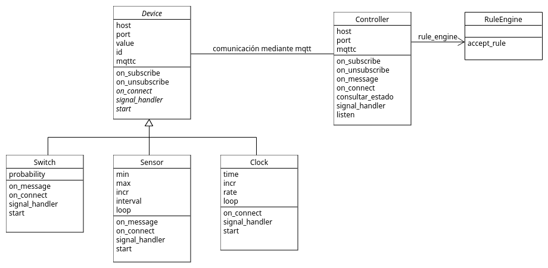

# Índice
1. [Introdución](#1-introducción)
2. [Definición del proyecto](#2-definición-del-proyecto)
3. [Implementación](#3-implementación)
4. [Diagramas](#4-diagramas)
5. [Conclusiones](#5-conclusiones)

# 1. Introducción
El objetivo de Saimazoom es el de crear un sistema para la gestión de dispositivos IoT online. Este sistema debe incluir a los actores:
* **Controlador**, que gestiona la comunicación entre los diferentes actores y las reglas del sistema.
* **Interruptores, sensores y relojes** dispositivos IoT.
* **RuleEngine**, encargado de reconocer las reglas del sistema y decidir si se cumplen las condiciones de alguna de las anteriores.

El sistema debe de gestionar las interacciones entre todos estos actores, para las comunicaciones correspondientes se empleará una cola de mensajes publisher-subscriber, en concreto, el broker Mosquitto.

# 2. Definición del proyecto
Nuestra aplicación web de Django, Domotics I&V, ofrece un soporte gráfico a los usuarios que quieren gestionar diversos dispositivos IoT. Esta interfaz les comunica con el controlador, que es quien en verdad gestiona las comunicaciones e interacciones de los diferentes dispositivos entre sí, y permite realizar acciones sobre dispositivos, reglas asociados a estos, y eventos generados cuando se cumplen las condiciones de una regla.

## 2.1. Objetivos y funcionalidad
Los objetivos principales son: 
* La gestión de las pedidos de los usuarios, que pueden añadir, ver, editar y borrar dispositivos, reglas y eventos.
* La gestión de la comunicación entre controlador e interruptores, de los que puede consultar su estado, y mandarles una acción a realizar.
* La gestión de la comunicación entre controlador y sensores, de los que puede consultar su estado, y recibir los cambios de estado que estos sufren periódicamente.
* La gestión de la comunicación entre controlador y relojes, de los que recibe los cambios de estado que estos sufren periódicamente.

Para cumplir estos objetivos es necesario desarrollar una serie de funcionalidades básicas:
1. Establecimiento de comunicación mediante colas publisher-subscriber entre todos los actores y controlador.
2. Registro de dispositivos y reglas: registro en la base de datos del **controlador** central con la información asociada al objeto a registrar.
3. Comprobación de las reglas mediante RuleEngine cada vez que el controlador recibe una consulta o un cambio de estado.
4. Edición de dispositivos y reglas: modificación en la base de datos del **controlador** central a la información asociada al objeto a modificar.

## 2.2. Requisitos
Nos limitaremos a los requisitos funcionales, estos los podemos dividir en los siguientes apartados:

### 2.2.1. **Lógica de clientes**
**LoCl1**. Registro en la aplicación de uno o varios dispositivos en el que se recibe confirmación  
**LoCl2**. Registro en la aplicación de una o varias reglas asociadas a los dispositivos registrados  
**LoCl3**. Consulta en la aplicación de los eventos generados a medida que se producen cambios en los dispositivos  
**LoCl4**. Edición de dispositivos o reglas previamente registrados  

# 3. Implementación
Vamos a dividir la implementación en dos partes diferenciadas, la primera la parte de la comunicación entre los diferentes dispositivos y el controlador, y la segunda la relacionada con la interfaz de usuario, es decir, la parte de Django.

### Comunicación

- **Dispositivos**: para los dispositivos hemos hecho uso de la orientación a objetos de python, y hemos hecho una clase abstracta Device que engloba los atributos que comparten todos los dispositivos, como el identificador, el valor, el host y el puerto de conexión, y el cliente de conexión mqtt. De esta clase abstracta, heredan las clases Switch, Sensor y Clock, añadiendo cada uno a los atributos de la clase padre, los necesarios para su necesario funcionamiento. En la clase Sensor y clock hemos decidido iniciar el bucle de recepción de mensajes mediante loop_start, ya que deben de enviar simultáneamente, los cambios de estado que están sufriendo al controlador. Para la clase Switch, al responder siempre que reciba un mensaje iniciamos la comunicación mediante un loop_forever. Todas las clases tienen un manejador de señales que les permite cerrar el bucle de comunicación al pulsar Ctrl + C. Cada una de estas clases cuenta con una función start, que pone en marcha el dispositivo.

- **Controlador**: clase encargada de gestionar la comunicación entre los diferentes actores. Tiene acceso a la base de datos para comprobar los dispositivos registrados y así procesar sus mensajes además de generar eventos cuando se realiza una acción. Uno de sus atributos es una instancia de RuleEngine, al que consulta si un cambio de estado desencadena una regla, para realizar la acción pertinente. Posee una función listen, que inicia la escucha de este en busca de mensajes entrantes.

- **RuleEngine**: lo hemos separado de controlador por el simple hecho de facilitar la comprensión y modularización del código. Cuenta con una función de nombre accept_rule, que accede a la base de datos en busca de reglas desencadenadas por el cambio de estado de alguno de los dispositivos, y le comunica al controlador las accioness a realizar sobre los dispositivos destino de la regla.

- **Gestión de mensajes**: en la mayoría de los casos, la comunicación entre el controlador y los dispositivos es bidireccionales, y se realiza tanto el envío como la recepción de un mensaje por el mismo topic. En consecuencia, es tarea de cada actor identificar los mensajes dirigidos a él y diferenciarlos de aquellos que él mismo publica, por lo que en la función de callback de cada actor al recibir un mensaje, on_message, parseamos el mensaje y confirmamos que queremos procesarlo. Para más información sobre el formato de los mensajes y su sintaxis, comprobar el documento de comunicación.

- **dummies**: para lanzar cada uno de los dispositivos, hemos scritps de nombre dummy-(deviceType).py, que parsean la línea de comandos en busca de los argumentos necesarios, e inician el bucle de recepción de cada uno, realizando las acciones pertinentes. Para el parsea de la línea de comandos, hemos hechos uso de la biblioteca argparse. Para lanzar el controlador, podemos llamar al script que contiene la propia clase.

- **tests**: hemos implementado una serie de test a lo largo del desarrollo para comprobar el correcto funcionamiento de los actores y del proyecto como conjunto. Para especificaciones sobre cada uno e indicaciones para su uso, visitar la página de la Wiki de pruebas.

### Django

# 4. Diagramas

Incluimos a continuación un diagrama de clases que representa un pequeño esquema de la organización y comunicación entre las clases principales, para dar soporte visual.

# 5. Conclusiones
Nuestras conclusiones de esta práctica son bastante buenas. Hemos aprendido a como organizar un servidor de gestión de dispositivos donde actores independientes se deben comunicar sin saber nada de ellos. Para ello hemos aprendido a hacer uso colas de mensajes publisher-subscriber. En consecuencia, hemos afianzamos y mejorado conocimientos adquiridos en la anterior práctica en relación a las colas de mensajes, en específico las de tipo publisher-subscriber. También hemos ahondado aún más en el lenguaje Python, haciendo uso de clases abstractas, métodos abstractos, y librerías como paho, que permite interactuar con servidores mqtt. 

Por otro lado, nos ha servido para aprender a usar Django, una herramienta enormente útil para el desarrollo de aplicaciones web, que proporciona grandes utilidades, como su propia base de datos integrada. Indirectamente, hemos debido investigar sobre el lenguaje html, para poder realizar las vistas que integran el ámbito de nuestra aplicación.

En resumen, esta práctica nos ha ayudado a desarrollar conocimientos sobre diversos e interesantes ámbitos, que podemos relacionar con conocimientos teóricos previos y nos proporcionan un enfoque práctico muy beneficioso. Creemos que refleja bastante lo aprendido en teoría acerca de las colas de mensajes y pensamos que es una buena manera de afianzar estos conceptos y trasladarlos a un entorno real que podría darse en un servidor común.

